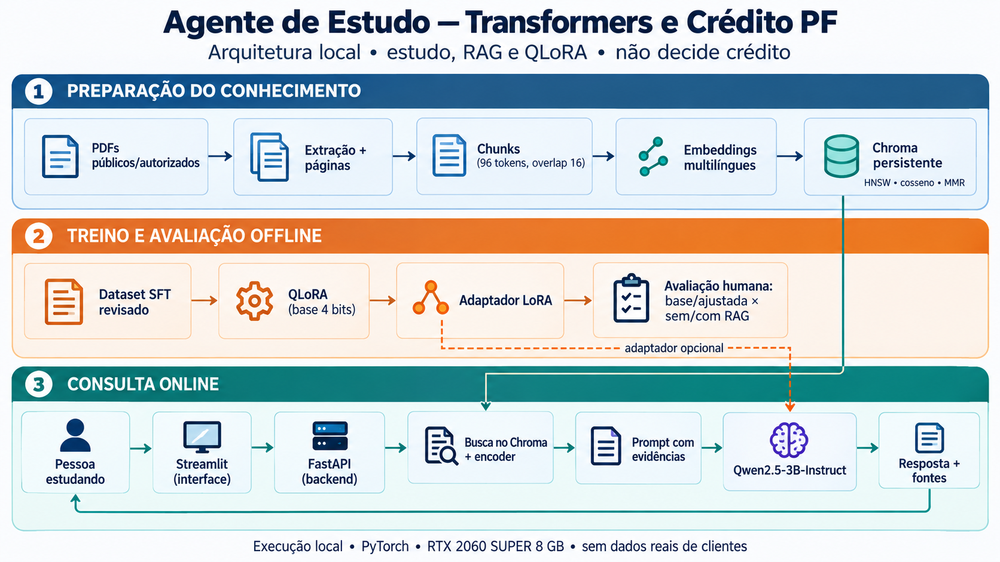
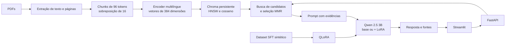
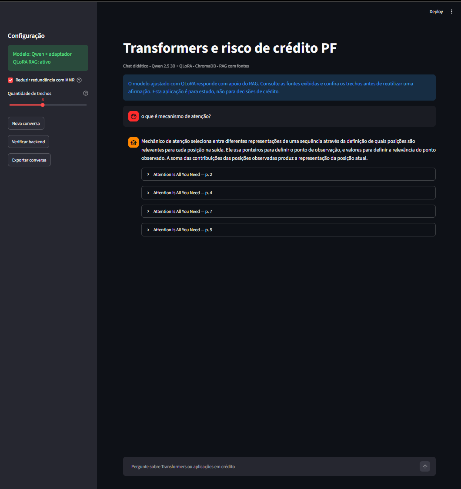

# Agente_IA_Transformers_Credito

---

# Guia de Estudos e Implementação — Transformers, RAG e QLoRA em Crédito PF

<p align="center">
  
</p>

> **Autor:** Leonardo Aderaldo Vargas<br>
> **Projeto:** agente local de estudo sobre Transformers e crédito para pessoa física<br>
> **Corpus:** artigos técnicos em PDF e exemplos sintéticos de instrução

> **Status:**

<p align="center">
  
</p>

---

# Sumário

1. Contexto e objetivo
2. Fundamentação teórica
3. Fontes de dados
4. Arquitetura
5. Como o projeto foi construído
6. Treinamento e avaliação
7. Resultados
8. Interface final
9. Como executar
10. Limitações e próximos passos

---

# Como Usar Este Guia

Este README registra o fluxo de construção do projeto, as decisões técnicas, os resultados medidos e as limitações observadas. A ideia é relacionar cada conceito ao componente que o implementa:

```text
Pergunta de estudo
       ↓
Representação vetorial e recuperação de evidências
       ↓
Prompt com contexto
       ↓
Qwen base ou Qwen com adaptador QLoRA
       ↓
Resposta, fontes e avaliação
```

Os notebooks numerados são o material principal de estudo. Cada etapa deixa artefatos que podem ser inspecionados e reutilizados pela seguinte. O projeto roda localmente em Python, PyTorch, FastAPI e Streamlit; **não utiliza Docker**.

## Resultado Atual

O adaptador QLoRA foi treinado por três épocas e salvo em `adaptador_pf/`. A comparação offline avaliou dez perguntas em quatro configurações: modelo base sem RAG, modelo base com RAG, modelo ajustado sem RAG e modelo ajustado com RAG.

Neste conjunto exploratório, o BERTScore F1 médio passou de **0,672 para 0,727** sem RAG e de **0,663 para 0,719** com RAG após o ajuste. O RAG, por sua vez, não elevou a média em relação às respostas sem recuperação. Uma consulta posterior também revelou trechos recuperados fora do tema da pergunta. Portanto, o ajuste apresentou um sinal favorável neste teste; a recuperação ainda precisa ser melhorada e validada.

---

# 1. Contexto e Objetivo

Transformers e modelos de linguagem podem apoiar a leitura de documentos técnicos, a explicação de conceitos e a exploração de hipóteses em crédito. O desafio do projeto é montar, passo a passo, um assistente local que consulte um corpus, apresente suas fontes e permita comparar geração sem contexto, geração com RAG e geração após fine-tuning.

O caso de crédito PF é utilizado como contexto de estudo, não como aplicação de concessão ou decisão de crédito. O projeto não recebe dados de clientes nem calcula PD, BAD rate ou rentabilidade em produção.

## Objetivos

- compreender tokenização, embeddings, atenção e geração autorregressiva;
- extrair texto de PDFs e manter rastreabilidade de fonte e página;
- construir uma busca vetorial persistente e inspecionar seus resultados;
- conectar recuperação e geração por meio de RAG;
- adaptar o comportamento de geração com QLoRA;
- avaliar quatro configurações com métricas automáticas e revisão humana;
- disponibilizar uma interface local para consulta e inspeção das evidências.

---

# 2. Fundamentação Teórica

## Transformer e geração

O Qwen recebe tokens e produz uma distribuição de probabilidade para o próximo token. A geração é autorregressiva: cada token previsto passa a fazer parte do contexto usado para prever o seguinte.

A atenção permite que uma posição da sequência atribua pesos a outras posições. Uma forma simplificada do mecanismo é:

```text
Attention(Q, K, V) = softmax((Q × Kᵀ) / √dₖ) × V
```

As matrizes (Q), (K) e (V) são projeções das representações de entrada. Esse mecanismo ajuda o modelo a combinar informações de diferentes posições; não constitui, por si só, uma explicação causal das previsões.

## Embeddings e similaridade de cosseno

O encoder multilíngue transforma uma pergunta ou um trecho em um vetor. Para comparar dois vetores (q) e (x), utiliza-se a similaridade de cosseno:

```text
cos(q, x) = (q · x) / (||q||₂ × ||x||₂)
```

Quando os vetores são normalizados para norma 1, o cosseno equivale ao produto escalar. A medida ajuda a ordenar trechos por proximidade no espaço do encoder; não indica probabilidade de relevância nem garante que uma resposta esteja correta.

## Busca vetorial: HNSW e MMR

O HNSW organiza vetores em um grafo e procura vizinhos próximos sem comparar necessariamente a consulta com todos os itens do índice. É uma busca aproximada: pode reduzir o custo em corpora maiores, mas pode não recuperar exatamente os mesmos vizinhos de uma busca exata.

Depois da busca inicial, o MMR seleciona trechos tentando equilibrar relevância para a pergunta e diversidade entre as passagens. No fluxo usado aqui, são consultados candidatos e selecionados até quatro trechos finais. A diversidade pode reduzir redundância, mas também pode excluir uma passagem complementar; por isso, os resultados precisam ser inspecionados.

## RAG

RAG significa *Retrieval-Augmented Generation*. Primeiro, recuperam-se trechos do corpus; depois, esses trechos são incluídos no prompt enviado ao Qwen. O RAG fornece contexto no momento da consulta, mas não altera os pesos do modelo. A LLM continua responsável por redigir a resposta e pode interpretar mal ou extrapolar o material recuperado.

## Fine-tuning com QLoRA

LoRA congela os pesos originais (W) e aprende uma atualização de baixo posto:

```text
W' = W + (α / r) × B × A
```

QLoRA mantém a base quantizada e congelada enquanto treina os adaptadores LoRA. Neste projeto, a base é carregada em 4 bits com NF4 e cálculo FP16; os adaptadores têm rank (r=8), escala (alpha=16) e são aplicados às projeções `q_proj` e `v_proj`. Assim, treinam-se poucos parâmetros em comparação com o ajuste completo, embora a base ainda precise participar do forward e ocupar memória.

RAG e QLoRA resolvem problemas diferentes: o primeiro acrescenta evidências consultáveis; o segundo adapta padrões de resposta a partir de exemplos supervisionados.

## Métricas de texto

A similaridade de cosseno compara um embedding por resposta. O BERTScore compara tokens com representações contextuais e resume correspondências por precisão, revocação e F1. As métricas avaliam proximidade em relação a uma resposta de referência, não factualidade, qualidade de citação ou fidelidade às fontes. Por isso, a avaliação inclui também uma rubrica de revisão humana.

---

# 3. Fontes de Dados

## Corpus documental

O corpus é composto por três artigos técnicos:

- [Attention Is All You Need](https://arxiv.org/abs/1706.03762) — arquitetura Transformer e atenção;
- [Predicting Consumer Default: A Deep Learning Approach](https://arxiv.org/abs/1908.11498) — previsão de inadimplência de consumidores;
- [PRAGMA: Revolut Foundation Model](https://arxiv.org/abs/2604.08649) — modelagem de sequências financeiras.

Os arquivos e metadados estão catalogados em `documentos/catalogo.json`. Os PDFs são usados para consulta e indexação; o catálogo marca todos como **não autorizados para treinamento**.

## Dataset de instrução

O arquivo `dataset_sft.jsonl` contém mil exemplos sintéticos, divididos em 800 para treino, 100 para validação e 100 para teste. Os exemplos cobrem cinco famílias temáticas: Transformers, crédito PF, RAG e recuperação, QLoRA e avaliação/governança.

Os exemplos não foram extraídos dos artigos. As famílias aparecem nos diferentes splits, embora as perguntas sejam distintas. Assim, o teste mede novas perguntas dentro de temas conhecidos; não comprova generalização para temas inéditos nem desempenho em uma população real de crédito.

---

# 4. Arquitetura



O encoder `sentence-transformers/paraphrase-multilingual-MiniLM-L12-v2` é usado na busca semântica. Ele não é a LLM geradora. O Qwen 2.5 3B Instruct é o único modelo de geração.

---

# 5. Como o Projeto Foi Construído

| Etapa | Arquivo | O que foi feito e por quê |
|------:|----------|---------------------------|
| 00 | [Ambiente, tokenização e LLM](./00_ambiente_tokenizacao_e_llm.ipynb) | Carregamento local do Qwen, inspeção de tokens, template de conversa e geração sem documentos. A base em 4 bits viabiliza o experimento na GPU disponível. |
| 01 | [Extração e chunks](./01_documentos_extracao_e_chunks.ipynb) | Extração de texto e páginas dos PDFs; divisão em janelas de até 96 tokens com 16 de sobreposição; criação de embeddings normalizados e arquivos intermediários. |
| 02 | [Banco vetorial](./02_banco_vetorial_hnsw_cosseno_e_mmr.ipynb) | Persistência de textos, metadados e vetores no Chroma. Configuração HNSW usa cosseno, até 16 vizinhos por nó, `ef_construction=100` e `ef_search=100`. Também se compara busca aproximada, busca exata e MMR. |
| 03 | [RAG com fontes](./03_rag_com_fontes_e_qwen.ipynb) | Recuperação de trechos antes da geração, inclusão deles no prompt e exibição de fonte e página para inspeção. |
| 04 | [Fine-tuning QLoRA](./04_fine_tuning_qlora.ipynb) | Preparação dos exemplos, supervisão apenas da resposta do assistente, congelamento da base quantizada e treinamento do adaptador. O melhor adaptador é salvo em `adaptador_pf/`. |
| 05 | [Avaliação comparativa](./05_avaliacao_base_rag_e_ajuste.ipynb) | Comparação de modelo base/ajustado, cada um com/sem RAG, sobre dez perguntas. São guardadas respostas, fontes, latências, cosseno, BERTScore e material para avaliação humana. |
| 06 | [Interface Streamlit](./06_interface_web.py) e [API FastAPI](./app_api.py) | Interface local que envia perguntas à API. A configuração atual usa o modelo ajustado com RAG; MMR e quantidade de trechos permanecem ajustáveis. |

Os arquivos `rag.py` centralizam funções compartilhadas de recuperação, montagem do prompt, carregamento do Qwen e geração. O notebook integrado antigo não faz parte do fluxo principal: a sequência recomendada é executar os notebooks numerados.

## Preparação dos documentos

Cada página é dividida em chunks para caber no contexto do encoder e preservar uma ligação rastreável entre texto, documento e página. As janelas se sobrepõem em 16 tokens: isso ajuda a manter uma informação que atravessa a fronteira entre chunks, embora acrescente conteúdo repetido ao índice.

Os vetores são gravados junto a seus textos e metadados. A coleção persistente pode então ser consultada sem recalcular a extração e os embeddings a cada pergunta.

## Recuperação e resposta

Para uma consulta, a API calcula o embedding da pergunta, busca candidatos no Chroma e aplica MMR quando habilitado. Por padrão, envia até quatro trechos ao prompt. O Qwen recebe pergunta e evidências e produz a resposta; as fontes retornadas pela API podem ser abertas na interface.

Essa separação ajuda a diagnosticar falhas: uma resposta ruim pode ocorrer porque o trecho adequado não foi recuperado, porque o contexto foi mal interpretado ou por ambos os motivos.

## Treinamento QLoRA

Na preparação dos lotes, os tokens da pergunta e das instruções não entram na loss; a supervisão é aplicada aos tokens da resposta do assistente. O treinamento usa AdamW, taxa de aprendizado (10^{-4}), três épocas e acumulação de gradientes. A loss de validação caiu de **0,781** na primeira época para **0,109** na terceira. Esse resultado mostra ajuste aos exemplos sintéticos, mas não demonstra melhora factual ou adequação a crédito real.

---

# 6. Avaliação

A avaliação seleciona de forma determinística dez perguntas do split de teste e gera uma resposta para cada uma das quatro condições, totalizando 40 gerações:

1. Qwen base sem RAG;
2. Qwen base com RAG;
3. Qwen + adaptador QLoRA sem RAG;
4. Qwen + adaptador QLoRA com RAG.

Os mesmos trechos recuperados são reutilizados nas duas condições com RAG. Isso evita que uma diferença de busca entre as perguntas seja confundida com o efeito do modelo.

A similaridade de cosseno e o BERTScore são calculados contra a resposta de referência. Também é gerado o arquivo `resultados/revisao_qualitativa_4_metodos.md`, que reúne as respostas e as fontes recuperadas e oferece campos para avaliar correção, cobertura, clareza, fidelidade e conteúdo inventado.

---

# 7. Resultados

| Configuração | Cosseno médio | BERTScore F1 médio | Tempo médio por resposta |
|--------------|--------------:|-------------------:|-------------------------:|
| Base sem RAG | 0,653 | 0,672 | 16,20 s |
| Base com RAG | 0,571 | 0,663 | 16,46 s |
| Ajustado sem RAG | 0,721 | 0,727 | 10,39 s |
| Ajustado com RAG | 0,711 | 0,719 | 11,78 s |

Os valores indicam que, neste teste, o ajuste aumentou o BERTScore F1 médio em aproximadamente **0,055** sem RAG e **0,056** com RAG. A similaridade de cosseno também foi maior nas duas comparações entre base e ajustado.

O RAG teve uma queda pequena na média em relação ao cenário sem recuperação: cerca de **0,009** no modelo base e **0,008** no ajustado. Portanto, os resultados não sustentam a conclusão de que o RAG melhorou as respostas nesta configuração. Trechos mais pertinentes podem ajudar, mas essa hipótese precisa ser testada depois de corrigir a recuperação.

**Limites da comparação:** são dez perguntas, os exemplos de fine-tuning são sintéticos e as métricas medem semelhança com referências curtas. Não há significância estatística estabelecida nem um resultado agregado da avaliação humana. Esses números não demonstram precisão factual, fidelidade às fontes ou impacto em aprovação, inadimplência ou rentabilidade.

## Diagnóstico de recuperação

Em uma consulta real feita pela API, a pergunta sobre como a atenção representa sequências recebeu trechos de outros documentos e páginas bibliográficas. O índice retornou, por exemplo, trechos de PRAGMA e de referências do artigo *Attention Is All You Need*, sem priorizar a passagem definicional esperada. A resposta gerada ficou incorreta.

Esse teste mostra que iniciar a aplicação não basta para validar a qualidade do RAG. Antes de confiar nas respostas, é necessário revisar a extração de PDFs, filtrar cabeçalhos e referências quando apropriado, inspecionar os chunks e avaliar a recuperação com perguntas e evidências anotadas. Aumentar (k) sozinho pode apenas acrescentar mais trechos irrelevantes.

---

# 8. Interface Final

A captura abaixo mostra a interface Streamlit, uma resposta e os expansores das fontes. Ela serve como **exemplo visual do fluxo**; não representa uma garantia de que a recuperação esteja correta para toda pergunta. O diagnóstico da seção anterior registra a limitação identificada na busca atual.

<p align="center">
  
</p>

A interface foi construída para estudo local. A API FastAPI recebe a consulta e as configurações de recuperação; o Streamlit mostra a resposta, as fontes e o histórico da sessão. O adaptador é aplicado ao Qwen quando a API é iniciada no modo ajustado.

---

# 9. Como Executar

## Ambiente

Usar o ambiente Conda `engenharia_ia_venv`, com PyTorch/CUDA compatível com a GPU. As versões das bibliotecas principais estão listadas em `requirements.txt`. Para calcular BERTScore no notebook 05, instalar também:

```powershell
conda activate engenharia_ia_venv
python -m pip install -r requirements.txt
python -m pip install bert-score==0.3.13
```

## Recriar o índice

Abrir e executar, nessa ordem, os notebooks 01 e 02 com o kernel `engenharia_ia_venv`. A etapa 01 extrai e prepara os documentos; a 02 persiste a coleção Chroma. O script `02_preparar_banco.py` automatiza essa sequência, mas está configurado para um kernelspec chamado `dsadlp1`; ao usar outro nome de kernel, executar os notebooks manualmente ou ajustar essa configuração.

## Executar a aplicação

Em um terminal PowerShell:

```powershell
conda activate engenharia_ia_venv
Set-Location D:\Projetos_v2\Agente_IA_Transformers_Credito
python -m uvicorn app_api:app --host 127.0.0.1 --port 8000
```

Em outro terminal, iniciar a interface:

```powershell
conda activate engenharia_ia_venv
Set-Location D:\Projetos_v2\Agente_IA_Transformers_Credito
python -m streamlit run 06_interface_web.py --server.port 8502
```

Acessar o endereço local exibido pelo Streamlit, normalmente `http://localhost:8502`. Manter os dois processos ativos. A primeira execução pode baixar o encoder ou o Qwen do Hugging Face e carregar o modelo na GPU. O adaptador `adaptador_pf/` precisa existir para usar o modo ajustado.

---

# 10. Limitações e Próximos Passos

- A avaliação quantitativa usa apenas dez perguntas e respostas de referência sintéticas.
- BERTScore e cosseno não verificam sozinhos factualidade nem suporte pelas fontes.
- O fine-tuning ajusta respostas dentro dos temas do dataset; não cria conhecimento confiável sobre os PDFs.
- A recuperação já apresentou resultados fora do tema em uma consulta real. É necessário auditar extração, chunks e ranking e criar um conjunto de perguntas com evidências relevantes anotadas.
- O corpus e os resultados são didáticos. Os artigos não comprovam ganho de um Transformer sobre LightGBM em crédito PF brasileiro.
- Uma investigação de crédito real exigiria unidade de análise definida, janelas de observação e performance, maturação do alvo, prevenção de leakage, validação temporal/Out-of-Time, calibração, estabilidade e impacto de política.
- Não há dados reais de clientes no projeto. A ferramenta não toma decisões de crédito e não deve ser utilizada para esse fim.

---

# Estrutura de Arquivos

| Arquivo ou pasta | Função |
|------------------|--------|
| `00_ambiente_tokenizacao_e_llm.ipynb` a `06_interface_web.py` | Trilha didática do carregamento do modelo à interface |
| `app_api.py` | API FastAPI local |
| `rag.py` | Recuperação, montagem do prompt, carregamento e geração |
| `dataset_sft.jsonl` | Exemplos sintéticos para o fine-tuning e avaliação |
| `documentos/catalogo.json` | Fontes, URLs, hashes e autorização de uso |
| `dados_processados/` | Chunks, embeddings e manifesto do corpus |
| `banco_chroma/` | Índice vetorial persistente |
| `adaptador_pf/` | Pesos LoRA e configuração do adaptador treinado |
| `resultados/` | Histórico de treino, respostas, métricas e revisão qualitativa |
| `img_01.png` | Diagrama geral do projeto |
| `tela_final.png` | Exemplo visual da interface Streamlit |

---

# Considerações Finais

O projeto percorre o ciclo de um assistente documental local: transforma PDFs em chunks e vetores, indexa os trechos, recupera evidências, gera respostas com Qwen, adapta o modelo com QLoRA e compara as configurações. O fine-tuning mostrou melhora de similaridade com as referências neste pequeno teste; o RAG ainda depende de corrigir a qualidade da recuperação.

A principal entrega é também metodológica: cada etapa deixa artefatos inspecionáveis, as limitações são registradas e resultados de similaridade não são confundidos com validação de risco de crédito.
